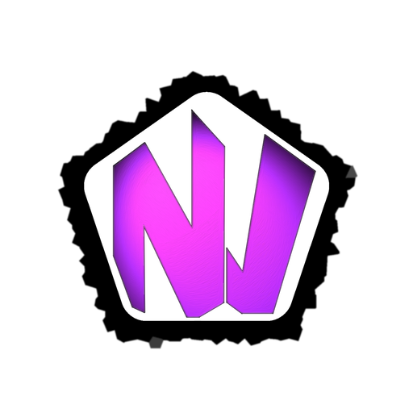
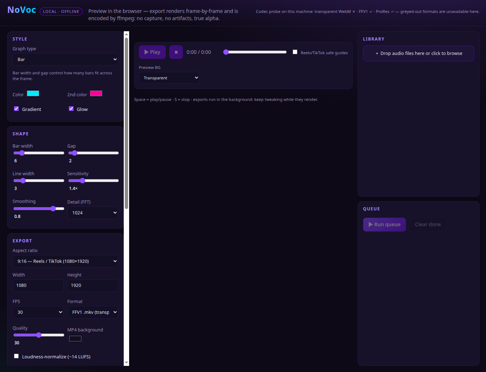
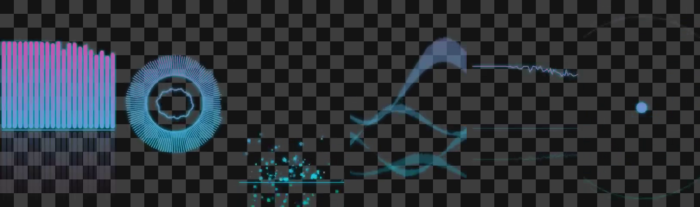

<p align="center">
  
</p>

# NoVoc - offline audio visualizer studio

**NoVoc** ("No Vocals") is a fully offline, self-contained visualizer studio inspired by
[audio-visualizer.com](https://audio-visualizer.com/). No npm dependencies, no build step, no internet.
Requires **Node.js 18+** and **ffmpeg** on your PATH.

1. **True transparency** — exports carry a real alpha channel (not green screen, not keyed
   black), so the visualizer drops over any background in your editor. The server probes
   your ffmpeg on startup and greys out any codec that would silently drop alpha here.
2. **Backend encoding, frame-exact** — exports are *not* screen recordings. The browser
   renders every frame deterministically from decoded audio and uploads PNGs; `ffmpeg`
   assembles the video server-side. Zero capture artifacts; preview == export.
3. **Reels/TikTok Preset** — 9:16 portrait default, safe-area guides in the preview
   (never in exports), loudness normalization presets.
4. **Studio workflow (v2)** — multi-track library, render queue with per-track settings,
   trim/fades, auto-save to your folder of choice with filename templates, and an instant
   scrubable MP4 proxy preview of every finished render.

## Supported platforms

| Way to run | Works on | You need |
|---|---|---|
| **Browser mode** — `node server.js`, open the page in any browser | Linux, macOS, Windows | Node.js 18+ and ffmpeg (6/7) on your PATH |
| **Desktop AppImage** — single file, windowed app | Linux x86_64 (any recent distro) | Nothing bundled-in: it ships its own Node runtime **and** ffmpeg |
| **Desktop RPM** — installs with a menu entry | Fedora / RHEL-family x86_64 | Nothing (the package carries everything) |

Developed and tested daily on Fedora (KDE) with Node 22 + ffmpeg 7.1. Browser mode is the
fully supported path on **all** operating systems; the windowed desktop builds are
Linux-only for now (Electron can also produce Windows `.exe` and macOS `.dmg`, but they
have never been built or tested here — contributions welcome).

## Built with local AI (transparency note)

This project was created with the substantial coding help of **Qwen3.8 Flash Next**,**running locally**, no code,
audio, or prompts were ever sent to any cloud AI service, and nothing phones home at
runtime (NoVoc needs no internet, ever).

## Run it

```bash
node server.js            # serves on http://localhost:8787
node server.js 8080       # or pick a port
```

Open **http://localhost:8787** in Chrome/Edge/Firefox. Everything runs locally.

## Desktop app (single file, no install)

The desktop build is the same server + dashboard wrapped in an Electron window — it bundles
its **own Node runtime and its own static ffmpeg**, so the target machine needs *nothing*
installed. Build it once:

```bash
npm install                # dev-only deps: electron + electron-builder (~1 min)
npm run vendor:ffmpeg      # fetches the static ffmpeg to bundle (once; it is deliberately
                           # NOT in the repo: 176 MB exceeds GitHub's per-file limit)
npm run dist               # → dist/NoVoc-2.0.0-x86_64.AppImage  (~178 MB)
npm run dist:rpm           # → dist/NoVoc-2.0.0-x86_64.rpm       (~131 MB, needs rpmbuild)
npm run dist:smoke         # builds, then headless-verifies the packaged app boots + probes codecs
```

Run it:

- **AppImage:** `chmod +x NoVoc-2.0.0-x86_64.AppImage && ./NoVoc-2.0.0-x86_64.AppImage`.
  On distros without the FUSE 2 library (Fedora 43+, e.g.) run it as
  `./NoVoc-2.0.0-x86_64.AppImage --appimage-extract-and-run` instead.
- **RPM:** `sudo dnf install dist/NoVoc-2.0.0-x86_64.rpm` — gets a normal menu entry and
  needs no FUSE at all; this is the smoothest option on Fedora.
- While developing: `npm run desktop` runs the shell against the live source files.

Notes:

- The bundle is read-only, so the desktop app keeps its **writable data at
  `~/Documents/NoVoc/`** (settings + `out/` job staging). Your auto-save *Results*
  folder is chosen in the app and is independent of this.
- The window *is* the browser page — no separate Chrome process, no `node server.js`.
  Idle footprint measured on this machine: ~570 MB total (window + server child);
  during exports the heavy lifting is done by the bundled ffmpeg process, not RAM.
- The transparency probe runs against the **bundled** ffmpeg at every start, so the
  grey-out behaviour is identical on every machine you drop this file onto.

## The dashboard



```
┌ styles / shape / export / length / auto-save │ preview stage │ library │ queue ┐
```

- **Library (right side)** — drop in one or many audio files (MP3, WAV, M4A, OGG, FLAC).
  Each track keeps its own decode cache; click *Load* to edit, *+ Queue* to enqueue a
  render of it with the current settings.
- **Queue** — every queued item snapshots *all* settings (style, colors, size, fps, format,
  trim, fades, save folder) at enqueue time, so changing controls afterwards never affects
  queued work. Hit **Run queue**: items render one after another in the browser while
  ffmpeg encodes overlap in the background. Finished items get **▶ Preview**, **⬇** and
  **↻ Redo**; failed items get **↻ Retry**.
- **Length & fades** — set in/out points (mark buttons use the playhead position) and
  audio+visual fades. Everything downstream (export, proxy, auto-save) only contains and
  fades the selected segment.
- **Auto-save** — pick a folder and a filename template once; every finished render is
  copied there automatically. Tokens: `{name} {w} {h} {fps} {style} {id} {date} {time}`.
- **Preview render** — after any export, hit *▶ preview render* to watch a scrubable
  proxy MP4 (h264, shown over a checkerboard so you can judge where the transparency is)
  before pulling the mezzanine file into your editor.

## Export formats

| Format | Transparency | Notes |
|---|---|---|
| **FFV1 (.mkv)** | ✅ lossless alpha | Best default for compositing. Smaller than ProRes, mathematically lossless. DaVinci Resolve, Premiere (with codec pack) and most NLEs accept it. |
| **ProRes 4444 (.mov)** | ✅ 12-bit alpha | The editor-friendly choice — imports natively into Premiere, Resolve, FCP with alpha. Large files. |
| **WebM VP9 (.webm)** | ✅ *if your ffmpeg supports VP9 alpha* | Small + transparent, web-playable. **Caveat:** some libvpx builds (e.g. libvpx 1.15 on some Linux distros) silently discard VP9 alpha. |
| **MP4 H.264 (.mp4)** | ❌ solid background of your choice | Ready to upload directly to TikTok/Reels/YouTube, maximum compatibility. |

### The transparency probe

On startup the server encodes tiny test frames with each transparent codec and verifies
the alpha channel actually survives decode **on your machine**. Broken options are greyed
out with an explanation, a working default is auto-selected, and the server refuses any
job that would come out opaque. Result on this repo's test machine (Fedora, ffmpeg 7.1,
libvpx 1.15): `{ webmAlpha: false, ffv1Alpha: true, proresAlpha: true }`.

Compositing tip: place the transparent export on a track above your background clip — the
alpha does the rest. For DaVinci Resolve, FFV1/ProRes alpha shows up as a proper
transparent layer automatically.

## Styles

18 styles, all deterministic and transparent-friendly: Bar, Wave, Line, Radial Bars,
Mirror Bars, Mountain, Blob, Siri, Hexagon Grid, Vinyl Record, Particle Vortex, Dot to
Dot, **Neon Bars + Reflection**, **Radial Spectrum Ring**, **Particle Fountain**,
**Aurora Ribbons**, **Minimal Line**, **Bass Ripple**.



## Testing

```bash
bash test/make-sample.sh          # generates test/sample.wav (8 s demo track)
node test/spectrum.test.mjs       # DSP unit tests (FFT, band layout, envelopes)
node test/e2e.mjs                 # full browser E2E (needs google-chrome)
```

The E2E drives the real app through headless Chrome: load sample → export all four
formats → verify each with `ffprobe` + raw alpha-pixel inspection; plus v2 checks for
trim/fades (segment duration), proxy previews, auto-save with templates, and the queue
rendering per-item snapshots independently. It adapts to the local ffmpeg: if WebM alpha
is broken on the machine, it asserts the app detects that and falls back instead.

## How it works

- **Audio**: decoded once in the browser to mono Float32 PCM per track, shared by preview
  and export. The server keeps the original file purely for the audio track and pre-trims
  it (`-ss/-to`) before encoding, so video/audio/fades stay in exact sync.
- **Spectrum**: hand-rolled radix-2 FFT + 256 log-spaced bands (32 Hz–16 kHz),
  AnalyserNode-compatible dB mapping, smoothing — identical code path for preview and
  export, so what you see is literally what you get, frame by frame.
- **Determinism**: every visualizer's state is a pure function of frame time/index
  (seeded RNG, no wall-clock, no Math.random), so frame #4321 looks pixel-identical
  whenever you render it.
- **Pipeline**: browser renders `t = trim.start + frame/fps` → PNG uploads (pool of 6) →
  ffmpeg encodes frames + trimmed/faded audio → proxy MP4 (checkerboard-composited,
  ≤480 px, h264+aac) for instant scrubbing → auto-save copy → frames pruned.
- **Settings**: save folder + template persist in `settings.json` at the project root;
  the queue can override them per item.

## Files

```
server.js            zero-dependency HTTP server + ffmpeg pipeline + codec probes + proxy
desktop/             optional Electron shell (main.cjs); vendor/ffmpeg fetched via npm run vendor:ffmpeg
logo/                project logo + square app icons (icon-512.png feeds the AppImage/rpm icon)
public/              the app (vanilla JS, no build step)
  index.html         dashboard layout
  app.js             library, queue, export client, preview
  lib/fft.js         iterative radix-2 FFT
  lib/spectrum.js    log-band spectrum + waveform analyzers
  lib/visualizers.js the 18 visual styles (all state deterministic)
test/                DSP unit tests + headless-Chrome E2E + AppImage smoke + helpers
docs/qa/             screenshots
out/jobs/<id>/       exports (frames pruned after encode; jobs > 24 h pruned)
settings.json        auto-save folder + filename template (local only, gitignored)
dist/                packaged builds (local only: AppImage / rpm)
```

## Releases

Prebuilt Linux x86_64 binaries (AppImage + RPM) are attached to the **Releases** section of
this repo — that's the no-compile way to use NoVoc. Everything in the *Desktop app* section
above is only for building those binaries yourself from source.
